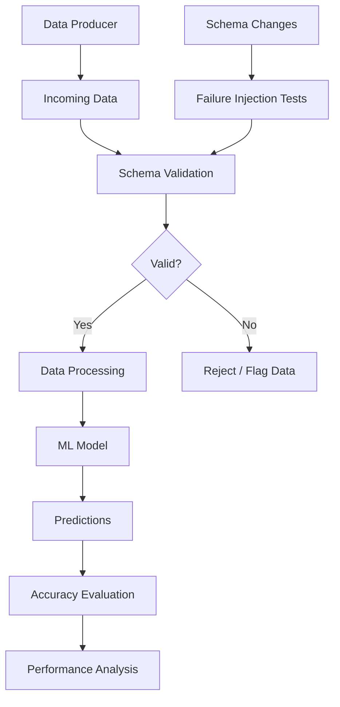

# Schema Evolution and Data Contracts

## 📌 Overview

This project focuses on managing schema changes in data-driven applications using **Data Contracts and Schema Validation**.

Changes such as adding, renaming, or removing fields can break downstream systems and silently affect ML model performance. This project aims to detect incompatible changes early and maintain data reliability.

## 🎯 Objectives

- Implement schema validation using data contracts.
- Identify compatible and breaking schema changes.
- Perform failure-injection testing.
- Analyze the impact of schema changes on ML model accuracy.
- Reduce silent failures in downstream systems.

## 🏗️ Architecture



## 🛠️ Technologies

- Python
- Pydantic
- Pandas
- Scikit-learn
- Pytest
- Matplotlib

## 🚀 Setup and Installation

**1. Clone the repository**

```bash
git clone <YOUR_REPOSITORY_URL>
cd <PROJECT_DIRECTORY>
```

**2. Create a virtual environment**

```bash
python -m venv venv
```

**3. Activate the environment**

Windows:
```bash
venv\Scripts\activate
```

**4. Install dependencies**

```bash
pip install -r requirements.txt
```

**5. Run the project**

```bash
python main.py
```

**6. Run tests**

```bash
pytest -v
```

## 📊 Evaluation

The project evaluates:

- Schema validation and breaking change detection.
- Number of silent failures.
- ML model accuracy with and without schema validation.
- Reliability of downstream data processing.

## 📝 Conclusion

This project demonstrates how data contracts, schema validation, and automated testing can help detect incompatible schema changes, reduce silent failures, and maintain reliable machine learning pipelines.
